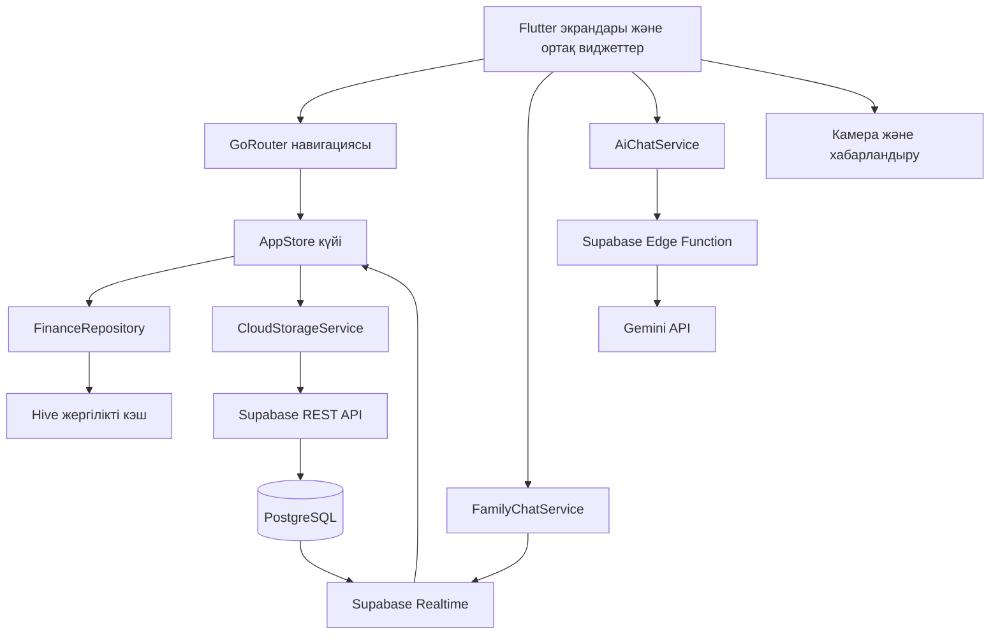

# Отбасы капиталы архитектурасы

## Қабаттар

| Қабат | Орналасуы | Міндеті |
|---|---|---|
| Интерфейс | `lib/features`, `lib/shared/widgets` | Экрандар, форма, навигация және қолжетімділік |
| Қолданба күйі | `lib/app/app_store.dart` | CRUD, есептеулер, бұлтпен синхрондау және Realtime күйі |
| Дерек қызметтері | `lib/core/services` | Hive, Supabase REST, Storage, хабарландыру және ЖИ |
| Бұлт | `supabase/migrations`, `supabase/functions` | PostgreSQL, RLS, Realtime және Edge Function |
| Тест | `test` | Unit және Widget Test |

## Деректер ағыны

1. Пайдаланушы экраннан операция енгізеді.
2. `AppStore` модельді тексеріп, жергілікті сақтауға жазады.
3. `CloudStorageService` деректі Supabase REST API арқылы серверге жібереді.
4. `otbasy_entries` кестесіндегі өзгерісті Supabase Realtime stream береді.
5. `AppStore` жаңартылған тізімді алып, интерфейске `notifyListeners()` арқылы хабарлайды.

## Қауіпсіздік

- Авторизация Supabase Auth арқылы орындалады.
- Әр кестеде Row Level Security қосылған.
- Gemini API кілті Flutter кодына жазылмайды. Ол Supabase Edge Function secrets ішінде сақталады.
- Төлем чектері жеке `receipts` Storage bucket ішінде сақталады.
